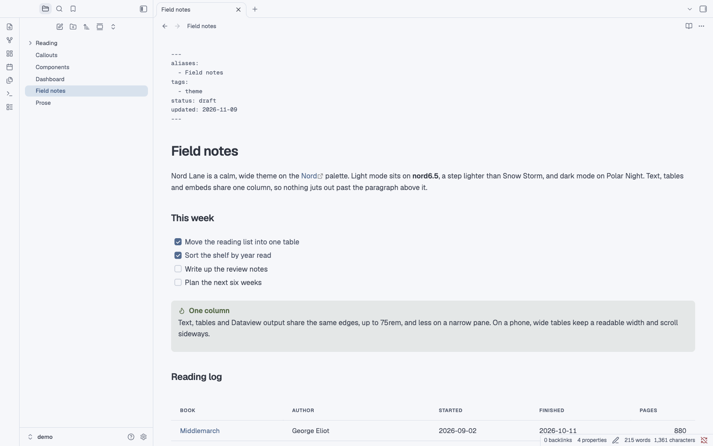
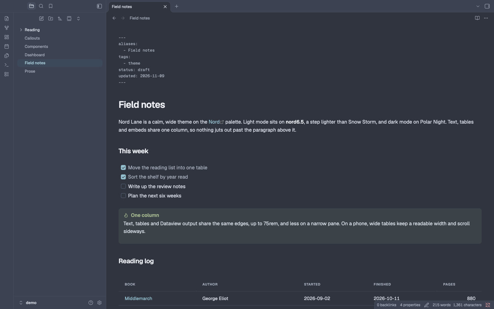

# Nord Lane

A calm, wide Obsidian theme on the [Nord](https://www.nordtheme.com) palette, with Geist and Geist Mono built in, Cyrillic included.





## What it does

- **Nord, light and dark.** Light mode puts every background on nord6.5 (`#F6F7FA`, halfway between nord6 and white) and separates areas with nord4 hairlines. Dark mode is Polar Night. Accents come from Frost and states from Aurora; where a Nord colour is too light for small text, the text takes a darker step of the same hue.
- **One column.** Text, tables, Dataview output and embeds share the same edges, up to 75rem, and less on a narrower pane. Live Preview and reading view look the same.
- **One table style** for markdown tables, Dataview tables and the Live Preview table editor: 15 px text, quiet uppercase headers, hairline rows, tabular numbers. Dataview's `-` placeholders show as a faint dash instead of an empty bullet. In a pane under 700 px, tables drop to 14 px, and wide ones keep a readable width and scroll sideways.
- **The same type everywhere.** Geist and Geist Mono are embedded, Latin and Cyrillic, so the iPhone and iPad render exactly what the Mac does.
- **Quiet frontmatter.** If you show properties as YAML source, the frontmatter is 13 px monospace in muted ink.
- **A heat calendar.** With the [Calendar](https://github.com/liamcain/obsidian-calendar-plugin) plugin, each day is a square shaded by how much its note holds, and the month fits any sidebar width.
- **Phones and narrow panes.** Layouts respond to the width of the note pane (container queries), so a narrow split on the Mac behaves like a phone.
- **Extras for dataviewjs dashboards.** `nl-*` classes (stats, tables, heatmaps, timelines) and `gc-*` cover cards for collections. They do nothing unless your own views use them; [docs/components.md](docs/components.md) shows the markup each one expects.

## Install

Until it's in the community theme browser:

1. Download [`theme.css`](theme.css) and [`manifest.json`](manifest.json).
2. Put both in `<your vault>/.obsidian/themes/Nord Lane/`.
3. Settings → Appearance → Themes → Nord Lane.

Or clone the repo and run `python3 build.py /path/to/vault`.

## Options

- `cssclasses: [full]` uses the whole pane width; `cssclasses: [table-mono]` sets a note's tables in monospace.
- `cssclasses: [prose]` keeps reading text to a comfortable measure: paragraphs, lists, headings and quotes stop at `--nl-prose-max` (46rem, about 95 characters), while tables, code, callouts, embeds and Dataview output keep the full column, all on the same left edge.
- `cssclasses: [hide-properties]` keeps a note's properties out of reading view (dashboards with `cssclasses: [dashboard]` do this too).
- With the [Style Settings](https://github.com/mgmeyers/obsidian-style-settings) plugin: Settings, Style Settings, Nord Lane. You can set the column width, table bleed, prose measure, table text size and frontmatter size, and turn on the Meta strip, which shows a `## Meta` section as one quiet strip in reading view.
- Without it, set the variables from a CSS snippet:

  ```css
  body {
    --nl-col-max: 60rem; /* the column, 75rem by default */
    --nl-bleed: 2rem;    /* how far tables and Dataview may hang past the text, 0 by default */
    --nl-prose-max: 40rem; /* the prose measure, 46rem by default */
    --table-text-size: 16px; /* 15px by default */
    --nl-frontmatter-size: 14px; /* 13px by default */
  }
  ```

**Size.** `theme.css` is about 225 KB, 163 KB of it the embedded fonts. Geist and Geist Mono each come in four subsets: Latin, Latin Extended (Central European accents such as č, ć, đ, š, ž), Cyrillic, and Cyrillic Extended (Ukrainian ґ, Kazakh letters). Obsidian loads it once. If you'd rather use fonts installed on your machine, `python3 build.py --no-fonts /path/to/vault` installs a 60 KB version.

**Accessibility.** In both modes every text colour reaches WCAG AA contrast on the backgrounds it's used on: 4.5:1 for text, including callout titles on their own tint and day numbers on heat cells, and 3:1 for faint secondary labels. `python3 tools/contrast.py` checks this, and so does CI.

Tested with Obsidian 1.15 on macOS, in Live Preview and reading view, light and dark, and in Obsidian's iPhone emulation.

## Develop

- Edit `src/theme.src.css`, then run `python3 build.py`. It embeds the fonts and writes `theme.css` and `manifest.json` here. Pass vault paths to install the theme into those vaults too.
- `demo/` is a small vault with sample notes for checking changes and taking screenshots: `python3 build.py demo`, then open the `demo` folder as a vault.
- `tools/live/` checks the theme in the real app (Node 22 or later). `./launch.sh` starts a separate Obsidian on the demo vault, with its own settings folder and a DevTools port. Then `node cdp.mjs run view.mjs "Field notes.md" source 1600 1000 light` saves one screen to `tools/live/shots/light.png`; `preview` gives reading view. `node cdp.mjs run phone.mjs 390 844 phone "Field notes.md=field"` does the iPhone layout, and `node cdp.mjs eval 'app.emulateMobile(false)'` goes back. `./reload-theme.sh` picks up a new build, and `./launch.sh stop` quits it. For your own vault, point `NL_VAULT` at a copy, never at a vault you have open.

## Credits

- Colours: [Nord](https://www.nordtheme.com) by Arctic Ice Studio and Sven Greb (MIT).
- Fonts: [Geist and Geist Mono](https://github.com/vercel/geist-font) by the Geist Project Authors, under the SIL Open Font License 1.1 ([`src/fonts/OFL.txt`](src/fonts/OFL.txt)).

## License

MIT, see [LICENSE](LICENSE). The embedded fonts keep their own license, the SIL Open Font License 1.1.
