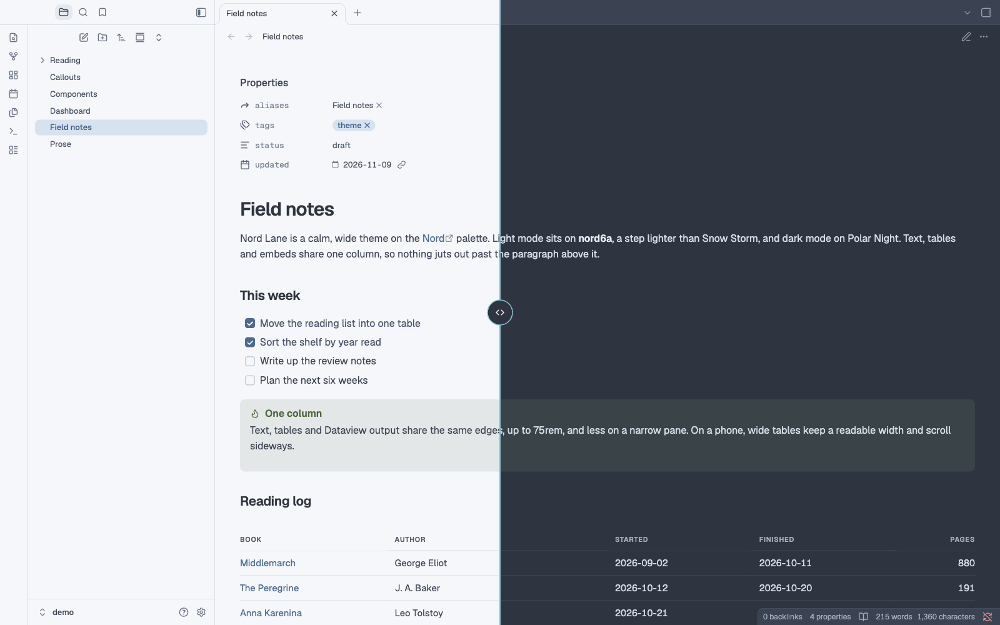
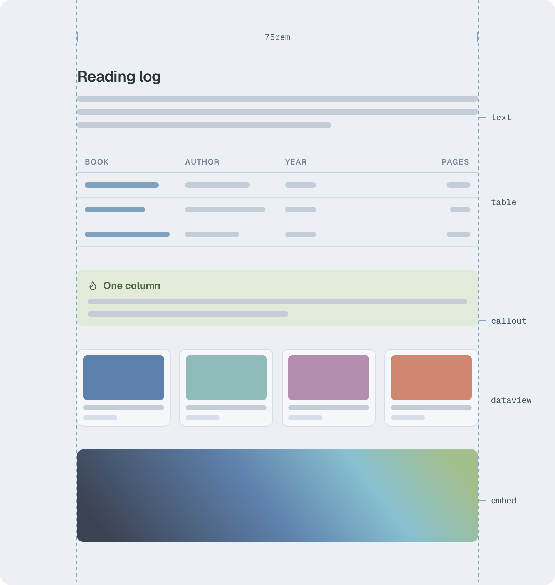
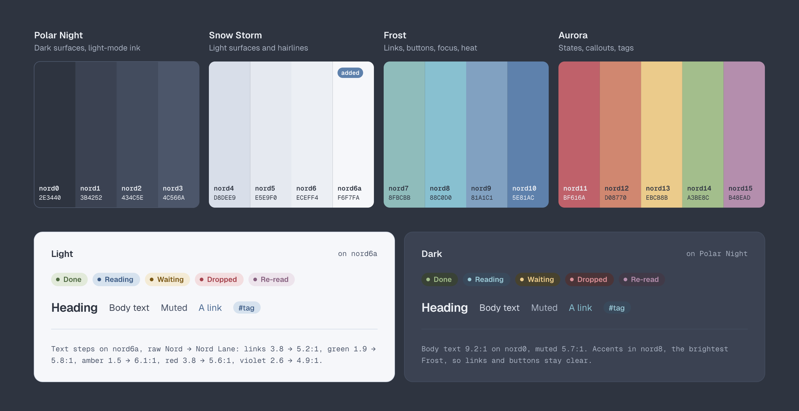
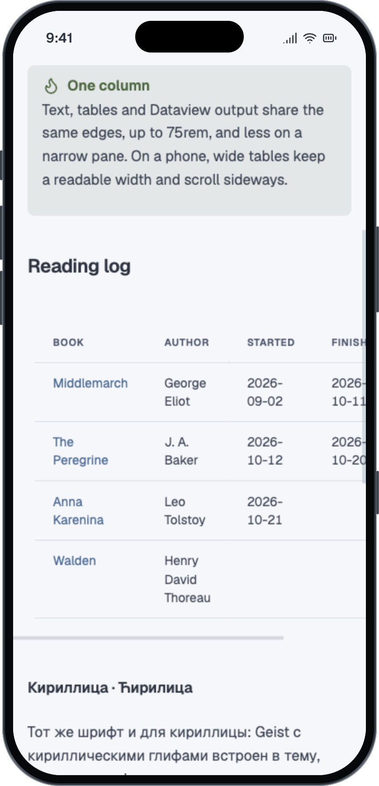
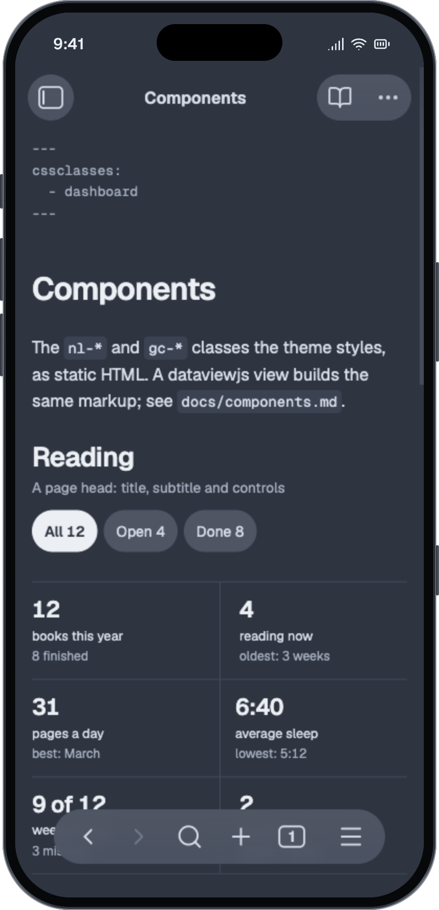
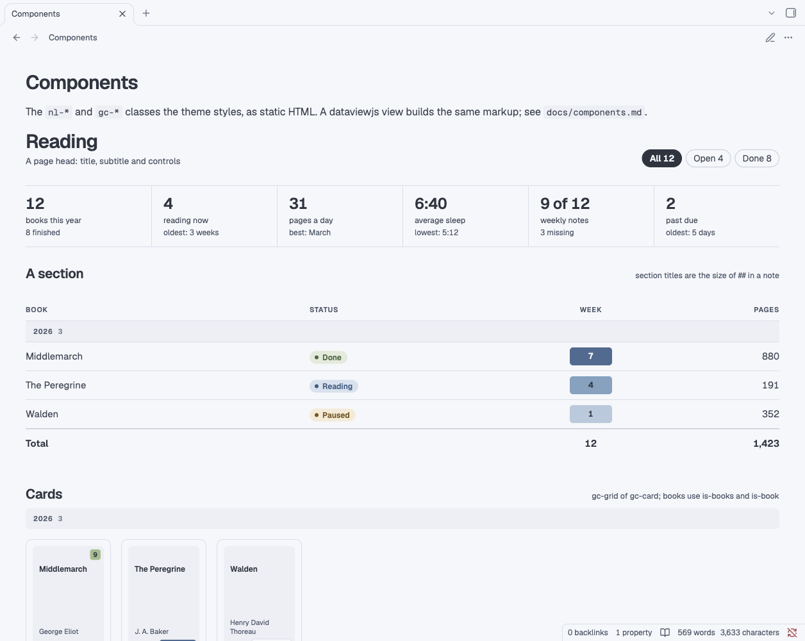

# Nord Lane

A calm, wide Obsidian theme on the [Nord](https://www.nordtheme.com) palette. Text, tables, Dataview output and embeds line up in one column, in light and dark, and your phone shows exactly what your desktop does.

**[Install](#install)** · [Options](#options) · [Components](docs/components.md) · [Changelog](CHANGELOG.md)



<sub>The demo vault's Field notes in reading view. Full size: [light](screenshots/light.png), [dark](screenshots/dark.png).</sub>

- **One column** for text, tables, Dataview output and embeds, up to 75rem.
- **One table style**, whether a table comes from Markdown, Dataview or the table editor.
- **Nord in light and dark**, with every text colour at WCAG AA contrast.
- **Geist and Geist Mono built in**, Latin and Cyrillic, the same on every device.
- **Phones and narrow panes** follow the width of the note pane, not the screen.
- **Dashboard and card classes** for your own dataviewjs views, if you want them.

## One column

Text, tables, Dataview output and embeds share the same edges, up to 75rem, and less on a narrower pane, so nothing juts out past the paragraph above it. Live Preview and reading view look the same.

<p align="center"></p>

## One table style

Markdown tables, Dataview tables and the Live Preview table editor share one look: 15 px text, quiet uppercase headers, hairline rows and tabular numbers. Dataview's `-` placeholders show as a faint dash instead of an empty bullet. In a pane under 700 px, tables drop to 14 px, and wide ones keep a readable width and scroll sideways.

## Nord, light and dark

Light mode puts every background on nord6a (`#F6F7FA`), a Snow Storm step halfway between nord6 and white, and separates areas with nord4 hairlines. Dark mode is Polar Night. Accents come from Frost and states from Aurora; where a Nord colour is too light for small text, the text takes a darker step of the same hue.



## The same type everywhere

Geist and Geist Mono are embedded with Latin and Cyrillic, Russian and Serbian alike, so phones and tablets render exactly what the desktop does. Layouts respond to the width of the note pane (container queries), so a narrow split on the desktop behaves like a phone, and touch targets are 44 px.

<p align="center">
  
  &nbsp;&nbsp;
  
</p>

## Dashboards and cards

`nl-*` classes give your dataviewjs views a page head, stat strips, pills, tables, heatmaps and timelines, and `gc-*` classes make cover cards for collections. They do nothing until a view uses them. [docs/components.md](docs/components.md) shows the markup each one expects, and `demo/Components.md` renders them all.



## Also

- **Quiet properties.** Properties follow Obsidian's "Properties in document" setting and are set quietly: 13 px, monospace keys. Shown as YAML source, the frontmatter is 13 px monospace in muted ink.
- **A heat calendar.** With the [Calendar](https://github.com/liamcain/obsidian-calendar-plugin) plugin, each day is a square shaded by how much its note holds, and the month fits any sidebar width.

## Install

Nord Lane needs Obsidian 1.5 or later. Until it's in the community theme browser:

1. Download [`theme.css`](theme.css) and [`manifest.json`](manifest.json).
2. Put both in a folder named `Nord Lane` inside your vault's themes folder: `<your vault>/.obsidian/themes/Nord Lane/`. Keep that exact name: it's the theme's name, and Obsidian's theme browser installs into the same folder.
3. Open Settings → Appearance and choose Nord Lane under Themes.

Or clone the repo and run `python3 build.py /path/to/vault`.

## Options

| What | How |
|---|---|
| Use the whole pane width in one note | `cssclasses: [full]` |
| Set one note's tables in monospace | `cssclasses: [table-mono]` |
| Keep reading text to a comfortable measure | `cssclasses: [prose]` |
| Keep one note's properties out of reading view | `cssclasses: [hide-properties]`, or `[dashboard]` |

`prose` stops paragraphs, lists, headings and quotes at `--nl-prose-max` (46rem, about 95 characters), while tables, code, callouts, embeds and Dataview output keep the full column, all on the same left edge.

With the [Style Settings](https://github.com/mgmeyers/obsidian-style-settings) plugin, open Settings, Style Settings, Nord Lane to set the column width, table bleed, prose measure, table text size and frontmatter size, and to turn on the Meta strip, which shows a `## Meta` section as one quiet strip in reading view. Without it, set the variables from a CSS snippet:

```css
body {
  --nl-col-max: 60rem;         /* the column, 75rem by default */
  --nl-bleed: 2rem;            /* how far tables and Dataview may hang past the text, 0 by default */
  --nl-prose-max: 40rem;       /* the prose measure, 46rem by default */
  --table-text-size: 16px;     /* 15px by default */
  --nl-frontmatter-size: 14px; /* 13px by default */
}
```

## Size, accessibility and testing

- **Size.** `theme.css` is about 225 KB, 163 KB of it the embedded fonts. Geist and Geist Mono each come in four subsets: Latin, Latin Extended (Central European accents such as č, ć, đ, š, ž), Cyrillic, and Cyrillic Extended (Ukrainian ґ, Kazakh letters). Obsidian loads it once. If you'd rather use fonts installed on your machine, `python3 build.py --no-fonts /path/to/vault` installs a 60 KB version.
- **Accessibility.** In both modes every text colour reaches WCAG AA contrast on the backgrounds it's used on: 4.5:1 for text, including callout titles on their own tint and day numbers on heat cells, and 3:1 for faint secondary labels. `python3 tools/contrast.py` checks this, and so does CI.
- **Testing.** Tested with Obsidian 1.15 on desktop, in Live Preview and reading view, light and dark, and in Obsidian's mobile emulation. Real phones and tablets are next ([#13](https://github.com/asilachev/nord-lane-obsidian/issues/13)).

## Develop

- Edit `src/theme.src.css`, then run `python3 build.py`. It embeds the fonts and writes `theme.css` and `manifest.json` here. Pass vault paths to install the theme into those vaults too.
- `demo/` is a small vault with sample notes for checking changes and taking screenshots: `python3 build.py demo`, then open the `demo` folder as a vault.
- `tools/live/` checks the theme in the real app (Node 22 or later). `./launch.sh` starts a separate Obsidian on the demo vault, with its own settings folder and a DevTools port. Then `node cdp.mjs run view.mjs "Field notes.md" source 1600 1000 light` saves one screen to `tools/live/shots/light.png`; `preview` gives reading view. `node cdp.mjs run phone.mjs 390 844 phone "Field notes.md=field"` does the phone layout, and `node cdp.mjs eval 'app.emulateMobile(false)'` goes back. `./reload-theme.sh` picks up a new build, and `./launch.sh stop` quits it. For your own vault, point `NL_VAULT` at a copy, never at a vault you have open.

## Credits

- Colours: [Nord](https://www.nordtheme.com) by Arctic Ice Studio and Sven Greb (MIT).
- Fonts: [Geist and Geist Mono](https://github.com/vercel/geist-font) by the Geist Project Authors, under the SIL Open Font License 1.1 ([`src/fonts/OFL.txt`](src/fonts/OFL.txt)).

## License

MIT, see [LICENSE](LICENSE). The embedded fonts keep their own license, the SIL Open Font License 1.1.
