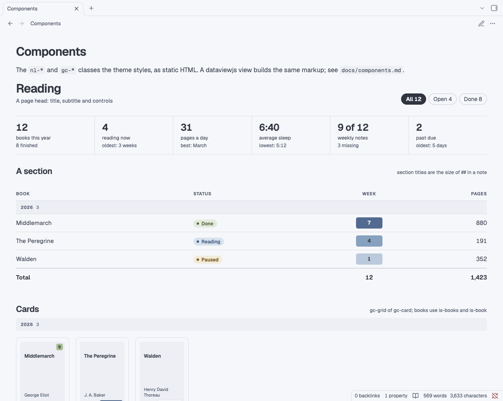

# Components

Nord Lane styles two families of classes for pages built with dataviewjs: `nl-*` for dashboards and `gc-*` for cover cards. The theme only styles them; your view writes the markup, usually with Obsidian's `createDiv` and `createEl`. They do nothing in notes that don't use them.

`demo/Components.md` shows the main pieces as static HTML:



## Page

Wrap a view in `.nl-page`. It sets the 14 px base and tabular numbers. Separate its parts with `.nl-block`.

```html
<div class="nl-page">
  <div class="nl-head nl-block">
    <div>
      <div class="nl-title">Reading</div>
      <div class="nl-sub">A subtitle</div>
    </div>
    <div class="nl-controls">…</div>
  </div>
  <div class="nl-block">…</div>
</div>
```

The controls are:

- `button.nl-btn`: a button, optionally with an SVG icon.
- `.nl-nav`: previous, label, next.
- `.nl-chips > button.nl-chip-btn`: filter chips; add `.is-active` to the chosen one.

## Sections

```html
<div class="nl-sec">
  <div class="nl-sec-t">Week by week</div>
  <div class="nl-sec-m">a note on the right</div>
</div>
```

Section titles are the size of `##` in a note.

## Stats

```html
<div class="nl-stats">
  <div class="nl-stat">
    <div class="nl-stat-v">12</div>
    <div class="nl-stat-l">books this year</div>
    <div class="nl-stat-s">8 finished</div>
  </div>
  …
</div>
```

- **Layout:** six per row, three in a pane under 1,100 px, two under 700 px. `--nl-stat-cols` changes the count.
- **Tone:** `.nl-tone-red`, `.nl-tone-green`, `.nl-tone-amber` or `.nl-tone-accent` on the value.

## Tables

```html
<div class="nl-tablewrap">
  <table class="nl-table">
    <thead><tr><th>Book</th><th class="al-r">Pages</th></tr></thead>
    <tbody>
      <tr class="nl-group"><td colspan="2"><span>2026</span><span class="nl-count">3</span></td></tr>
      <tr><td>Middlemarch</td><td class="al-r">880</td></tr>
      <tr class="nl-total"><td>Total</td><td class="al-r">880</td></tr>
    </tbody>
  </table>
</div>
```

- **Rows:** `tr.nl-group` is a band; `.nl-count` and `.nl-right` go inside it. `tr.nl-total` is the closing row.
- **Columns:** `.al-r` and `.al-c` align a column. `.wrap` lets a cell wrap to two lines. `.nl-hide-sm` hides a column under 700 px, and `.nl-hide-md` under 1,100 px.
- **Narrow panes:** under 700 px, `table.nl-stack` turns rows into stacked entries, labelled by each cell's `data-label`.
- **Wide tables:** `.nl-regular` and `.nl-turned` hold a wide table and its turned version, one row per week or month. The turned one shows in panes under 1,180 px.
- **Inside cells:**
  - `.nl-pill.accent`, `.green`, `.amber`, `.red`, `.violet` or `.neutral`
  - `.nl-heat.l1`, `.l2` or `.l3`: a heat cell
  - `.nl-chip`
  - `.nl-muted`, `.nl-faint`
  - `.nl-trunc`: an ellipsis
  - `.nl-thumb`: a small image

## Heat

The three shades are `--nl-heat-1`, `--nl-heat-2` and `--nl-heat-3`, and `--nl-on-heat-1/2/3` is the text on each. Both pass WCAG AA in both modes.

```html
<div class="nl-hm">
  <div class="nl-heatmap">
    <div class="nl-hm-col"><span class="nl-hm-m">Jan</span><i class="l1"></i><i></i><i class="l3"></i>…</div>
    …
  </div>
  <div class="nl-legend">…</div>
</div>
```

Each cell is an `i`. A bare `i` has a note with nothing to count, `i.none` has no note, `i.l1` to `i.l3` are the shades, and `i.future` is a day still to come. A column marked `.is-old` is dropped on narrow panes.

There are also bar charts (`.nl-bars`, `.nl-chart`) and a timeline (`.nl-timeline`, with `.nl-tl-*` parts for the axis, ticks, dots, blocks, labels and today's line). See section 10 of `src/theme.src.css`.

## Cards

```html
<div class="gc-grid">
  <div class="gc-card">
    <div class="gc-cover">
      
      <div class="gc-rating r8">8.2</div>
      <div class="gc-badge gc-bl">EN</div>
    </div>
    <a class="internal-link gc-title" data-href="Note">Title</a>
    <div class="gc-sub">Subtitle</div>
    <div class="gc-meta"><span>2021</span><span>1–4</span></div>
  </div>
</div>
```

- **Cover:** the frame is transparent, so a box that isn't square sits on the card. A cover without an image gets a filled `.gc-noart` placeholder.
- **Corners:**
  - `.gc-badge` with `.gc-tl` (top left), `.gc-bl` (bottom left) or `.gc-br` (bottom right)
  - `.gc-rating` with `.r5` to `.r8` (top right)
  - `.gc-po`: an accent badge
- **Below the title:**
  - `.gc-meta`
  - `.gc-ticks > i.on` (or `i.done`): progress ticks
  - `.gc-foot` with `.gc-plays` and `.gc-cost`
  - `.gc-strip`: small thumbnails
- **Variants:** `.gc-card.is-order` draws a dashed border. `.gc-card.is-row` lays a card on its side: the cover in a 72 px column and `.gc-body` beside it, holding the title, subtitle, meta and anything else, such as an `.nl-pill`. It suits one book next to a heatmap in `.nl-act-row`.
- **Books:** `.gc-grid.is-books` and `.gc-card.is-book` use 2:3 covers. `.gc-nocover > .gc-nocover-t + .gc-nocover-a` is a typeset stand-in, and `.gc-group` is a band across the grid.
- **Filtering:** set the `hidden` attribute on the cards that don't match.
